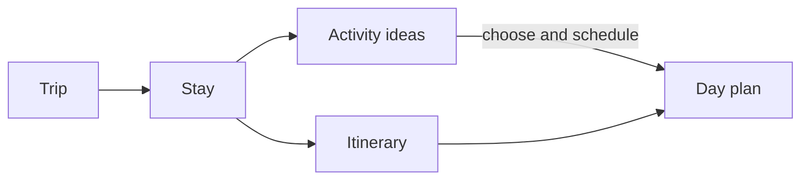
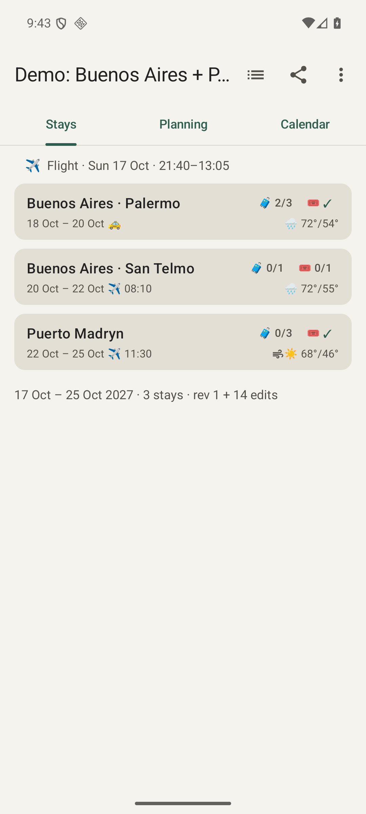
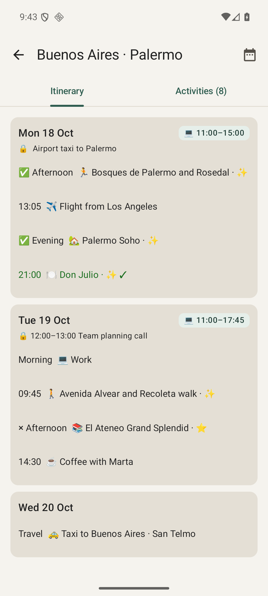
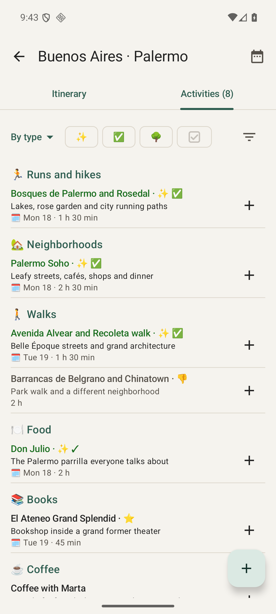
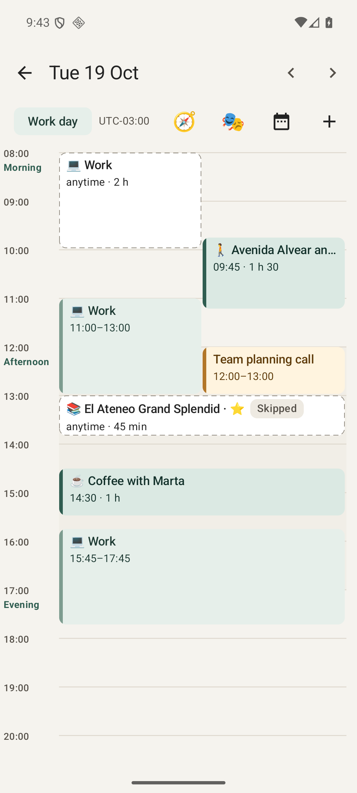
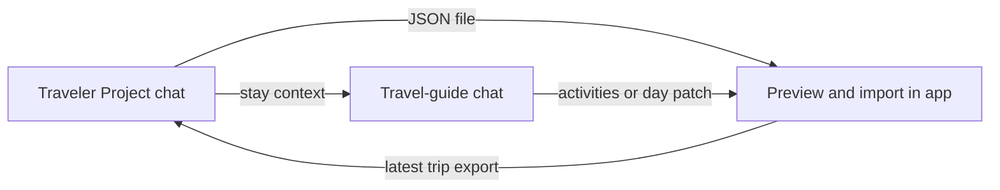

# Traveler

An offline-first Android travel companion: turn an assistant’s travel ideas into a plan you can carry, adjust and follow on your phone. The assistant prepares files; Traveler keeps your trip usable without a connection. Maps and external booking links need their own connectivity.

## The concepts

| Concept | What it means |
| --- | --- |
| **Trip** | The whole journey: dates, destinations, travel between them and plans. |
| **Stay** | A visit to one destination, with arrival/departure dates, lodging and a pool of activities. |
| **Activity** | Something you could do. It can remain an idea until you give it a place in a day. |
| **Itinerary** | Your day-by-day plan: selected activities alongside travel, bookings and work time. |
| **Day** | One date in the itinerary, with activities arranged around bookings, travel and work. |



**Ideas are flexible; bookings are commitments.** An activity can be suggested for the morning without having a fixed time. Reservations and travel give the day its constraints.

## The App

### See the journey, then zoom into a stay

<a href="docs/screenshots/trip.png"></a>
<a href="docs/screenshots/stay.png"></a>

**Trip (left):** the route at a glance—where you sleep, when you move on and what is booked. **Stay itinerary (right):** how those days fit together, with activities alongside travel and fixed commitments. Open a day to work on its schedule.

### Turn possibilities into a day you can follow

<a href="docs/screenshots/activities.png"></a>
<a href="docs/screenshots/day.png"></a>

**Activities (left):** your pool of ideas for the stay, including things you have scheduled, completed or ruled out. **Day (right):** the actual shape of your time. Dashed blocks are flexible suggestions; timed blocks show where activities and commitments land. Fill a gap, move an activity or leave an idea for another day.

Bookings, checklists, packing and notes are reached through the trip’s **Planning** tab. Changes save automatically and can be undone. During the trip, the app opens on today’s day when it belongs to a destination stay.

*Screenshots use the demo trip. Explore it through Settings → Load the demo trip.*

## ChatGPT — the Traveler Project

[Set up a Project named **Traveler**](integrations/skill/README.md) once. Use a trip-level chat for the overall journey and separate `/travel-guide` chats to explore individual stays. The commands below are messages to send in those chats.



### Create an itinerary

**Input:** destinations, dates, preferences and fixed commitments.

> Plan my Argentina trip for [dates]. Return an itinerary JSON for Traveler.

**Output:** a validated `<trip-id>.r1.trip.json` download and a short summary. Open it with Traveler and import it. If downloading is awkward, ask “paste” and use **Paste trip JSON** in the app.

### Explore a single stay

**Input:** the latest trip export, attached to the chat or available as a Project file. Link any separate stay itinerary you want considered as supporting context; the command starts from the trip JSON.

```text
/travel-guide --trip argentina --stay Santiago
```

**Output:** a stay brief drawn from the trip, followed by a focused research conversation. Ask about options, practicalities or a particular day; existing plans and work hours provide context. No file is produced until you request one.

### Add activity ideas to a stay

**Input:** the stay name and the ideas selected in your conversation. The full trip file is optional.

> Send these Santiago activities to Traveler as an activities file, without scheduling them.

**Output:** a `traveler-activities` JSON file. Import it to add ideas to the stay’s activity pool without replacing day plans.

### Plan a day and send it to the app

**Input:** the date, stay and what you want to do. Explore options in a `/travel-guide` chat, agree on a day plan, then ask to send it to the app.

```text
/send-day YYYY-MM-DD
```

Or ask: “Send the Santiago plan we just drafted for [date] to my app.”

**Output:** a **Daily Activity Patch** file, `<trip-id>.<date>.activities.json`, containing the activities and dated plan—not a whole-trip revision. Open it with Traveler or use **Day → + → Import day plan…** and review the dates in the preview. You can request several days together.

### Revise the whole trip

**Input:** a fresh export from the app’s trip overview share button, plus your change request.

> Revise this trip to [change]. Keep my edits and return an updated trip JSON.

**Output:** a new `.trip.json` revision. Import it and resolve any conflicts. Use the latest phone export so the chat starts with your current plan.

### Research lodging

**Input:** the latest trip export, the stay to research and any lodging preferences.

> Compare lodging for Santiago and add a shortlist to this trip.

**Output:** a trip revision with lodging candidates for that stay. Import it and compare them in **Planning**. Without a trip file, the output is a comparison in chat.

## Additional Documentation

- [Key data models — UML diagrams](docs/DATA-MODELS.md)
- [Trip file format](docs/trip-format.md) · [JSON Schema](schema/trip.schema.json) · [Example files](schema/examples/)
- [Assistant instructions](prompts/itinerary-instructions.md) · [ChatGPT setup](integrations/skill/README.md)
- [Desktop planner](docs/PLANNER-SITE.md) · [Google My Maps](docs/MAPS.md)
- [Architecture](docs/ARCHITECTURE.md) · [Build, test and install](docs/BUILD.md)
- [License — MIT](LICENSE)
