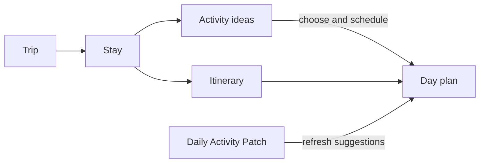
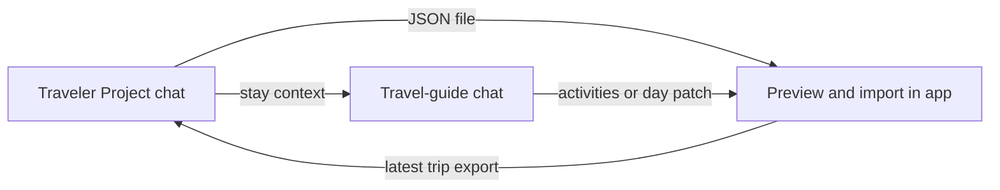

# Traveler

An offline-first Android travel companion: turn an assistant’s travel ideas into a plan you can carry, adjust and follow on your phone. The assistant prepares files; Traveler keeps your trip usable without a connection. Maps and external booking links need their own connectivity.

## The concepts

| Concept | What it means |
| --- | --- |
| **Trip** | The whole journey: dates, destinations, travel between them and plans. |
| **Stay** | A visit to one destination, with arrival/departure dates, lodging and a pool of activities. |
| **Activity** | Something you could do. It can remain an idea until you give it a place in a day. |
| **Itinerary** | Your day-by-day plan: selected activities alongside travel, bookings and work time. |
| **Daily Activity Patch** | A small assistant-generated file that refreshes a particular day’s suggestions without rewriting the whole trip. |



**Ideas are flexible; bookings are commitments.** An activity can be suggested for the morning without having a fixed time. Reservations and travel give the day its constraints.

## The App

### Your screens, at a glance

| Screen | The question it answers |
| --- | --- |
| **Trips** | Which journey am I planning or taking? |
| **Trip → Stays** | Where am I going, and in what order? |
| **Trip → Planning** | What needs booking or preparing? Reach events, checklists, packing and notes here. |
| **Trip → Calendar** | What does the journey look like across dates? |
| **Stay → Itinerary / Activities** | What is planned here, and what else could I do? |
| **Day** | What fits today? Arrange activities around bookings, travel and work; open the day’s route in Maps. |

During a trip, Traveler opens on today’s day when it belongs to a destination stay. Back takes you up through the stay’s itinerary to the trip. Explore **Settings → Load the demo trip** to try it.

### Plan, import and revise

- **On the phone:** schedule ideas, add bookings and notes, and mark activities done or skipped. Edits save automatically and can be undone.
- **Incoming files:** open or share them with Traveler, then review the import preview. If a file needs repair, copy its fix request back to ChatGPT.
- **Trip revisions:** Traveler merges your edits and asks you to resolve conflicting changes.
- **Day patches:** replace suggestions for the dates **inside the file**, preserving completed activities, booked activities and your own entries.

Personal trip notes, checklists and work-block adjustments stay on the phone, outside the assistant’s trip file. Backups include them; trip exports do not.

## ChatGPT — the Traveler Project

[Set up a Project named **Traveler**](integrations/skill/README.md) once. Use a trip-level chat for the overall journey and separate `/travel-guide` chats to explore individual stays. The commands below are messages to send in those chats.



### Create an itinerary

**Input:** destinations, dates, preferences and fixed commitments.

> Plan my Argentina trip for [dates]. Return an itinerary JSON for Traveler.

**Output:** a validated `<trip-id>.r1.trip.json` download and a short summary. Open it with Traveler and import it. If downloading is awkward, ask “paste” and use **Paste trip JSON** in the app.

### Explore a single stay

**Input:** the latest trip export, attached to the chat or available as a Project file. Link any separate stay itinerary you want considered as supporting context; the command starts from the trip JSON.

```text
/travel-guide --trip argentina --stay Santiago
```

**Output:** a stay brief drawn from the trip, followed by a focused research conversation. Ask about options, practicalities or a particular day; existing plans and work hours provide context. No file is produced until you request one.

### Add activity ideas to a stay

**Input:** the stay name and the ideas selected in your conversation. The full trip file is optional.

> Send these Santiago activities to Traveler as an activities file, without scheduling them.

**Output:** a `traveler-activities` JSON file. Import it to add ideas to the stay’s activity pool without replacing day plans.

### Send a Daily Activity Patch

**Input:** an agreed day plan, its exact date and the stay it belongs to. This works inside a `/travel-guide` chat too.

```text
/send-day YYYY-MM-DD
```

Or ask: “Send the Santiago plan we just drafted for [date] to my app.”

**Output:** `<trip-id>.<date>.activities.json`, containing the activities and dated plan—not a whole-trip revision. Open it with Traveler or use **Day → + → Import day plan…** and review the dates in the preview. You can request several days together.

### Revise the whole trip

**Input:** a fresh export from the app’s trip overview share button, plus your change request.

> Revise this trip to [change]. Keep my edits and return an updated trip JSON.

**Output:** a new `.trip.json` revision. Import it and resolve any conflicts. Use the latest phone export so the chat starts with your current plan.

### Research lodging

**Input:** the latest trip export, the stay to research and any lodging preferences.

> Compare lodging for Santiago and add a shortlist to this trip.

**Output:** a trip revision with lodging candidates for that stay. Import it and compare them in **Planning**. Without a trip file, the output is a comparison in chat.

## Additional Documentation

- [Key data models — UML diagrams](docs/DATA-MODELS.md)
- [Trip file format](docs/trip-format.md) · [JSON Schema](schema/trip.schema.json) · [Example files](schema/examples/)
- [Assistant instructions](prompts/itinerary-instructions.md) · [ChatGPT setup](integrations/skill/README.md)
- [Desktop planner](docs/PLANNER-SITE.md) · [Google My Maps](docs/MAPS.md)
- [Architecture](docs/ARCHITECTURE.md) · [Build, test and install](docs/BUILD.md)
- [License — MIT](LICENSE)
