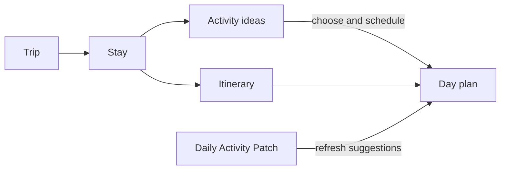
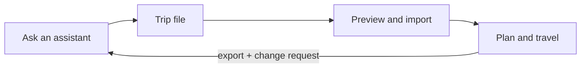

# Traveler

An offline-first Android travel companion: turn an assistant’s travel ideas into a plan you can carry, adjust and follow on your phone. The assistant prepares files; Traveler keeps your trip usable without a connection. Maps and external booking links need their own connectivity.

## The concepts

| Concept | What it means |
| --- | --- |
| **Trip** | The whole journey: dates, destinations, travel between them and plans. |
| **Stay** | A visit to one destination, with arrival/departure dates, lodging and a pool of activities. |
| **Activity** | Something you could do. It can remain an idea until you give it a place in a day. |
| **Itinerary** | Your day-by-day plan: selected activities alongside travel, bookings and work time. |
| **Daily Activity Patch** | A small assistant-generated file that refreshes a particular day’s suggestions without rewriting the whole trip. |

**Ideas are flexible; bookings are commitments.** An activity can be suggested for the morning without having a fixed time. Reservations and travel give the day its constraints.

## Your screens, at a glance

| Screen | The question it answers |
| --- | --- |
| **Trips** | Which journey am I planning or taking? |
| **Trip → Stays** | Where am I going, and in what order? |
| **Trip → Planning** | What needs booking or preparing? Reach events, checklists, packing and notes here. |
| **Trip → Calendar** | What does the journey look like across dates? |
| **Stay → Itinerary / Activities** | What is planned here, and what else could I do? |
| **Day** | What fits today? Arrange activities around bookings, travel and work; open the day’s route in Maps. |

During a trip, Traveler opens on today’s day when it belongs to a destination stay. Back takes you up through the stay’s itinerary to the trip.

## The loop

1. **Create a trip.** Give an assistant your destinations, dates and the [itinerary instructions](prompts/itinerary-instructions.md). Open or share its trip file with Traveler.
2. **Preview it.** Review the stays and warnings before importing. If the file needs repair, copy the fix request back to the assistant.
3. **Make it yours.** Schedule ideas, add bookings and notes, and mark activities done or skipped. Edits save automatically and can be undone.
4. **Adapt it.** Choose the smallest update that matches your need:

| You want to… | Workflow |
| --- | --- |
| **Get more ideas for a stay** | Ask for an activities file and import it. New ideas join the stay’s pool without replacing its schedule. |
| **Replan a particular day** | Ask for a **Daily Activity Patch** for that date. Open the file, or use **Day → + → Import day plan…**, then review the preview. |
| **Revise the broader trip** | Export the trip, ask the assistant for changes, and import its revision. Traveler merges your edits and asks you to resolve conflicting changes. |

A Daily Activity Patch replaces suggestions for the dates **inside the file**. Completed activities, booked activities and your own entries stay in place. It can be drafted in a fresh chat without sending the full trip.

Your personal trip notes, checklists and work-block adjustments stay on the phone, outside the assistant’s trip file. Backups include them; trip exports do not.

## Getting started

Explore **Settings → Load the demo trip**, or [set up a ChatGPT Project](integrations/skill/README.md) to generate your own plans.

For broader logistics research, the optional **desktop planner** organizes lodging and transport and exchanges trip revisions with the phone. A **My Maps export** gives you an overview map and a layer for each stay.

## Additional Documentation

- [Key data models — UML diagrams](docs/DATA-MODELS.md)
- [Trip file format](docs/trip-format.md) · [JSON Schema](schema/trip.schema.json) · [Example files](schema/examples/)
- [Assistant instructions](prompts/itinerary-instructions.md) · [ChatGPT setup](integrations/skill/README.md)
- [Desktop planner](docs/PLANNER-SITE.md) · [Google My Maps](docs/MAPS.md)
- [Architecture](docs/ARCHITECTURE.md) · [Build, test and install](docs/BUILD.md)
- [License — MIT](LICENSE)
