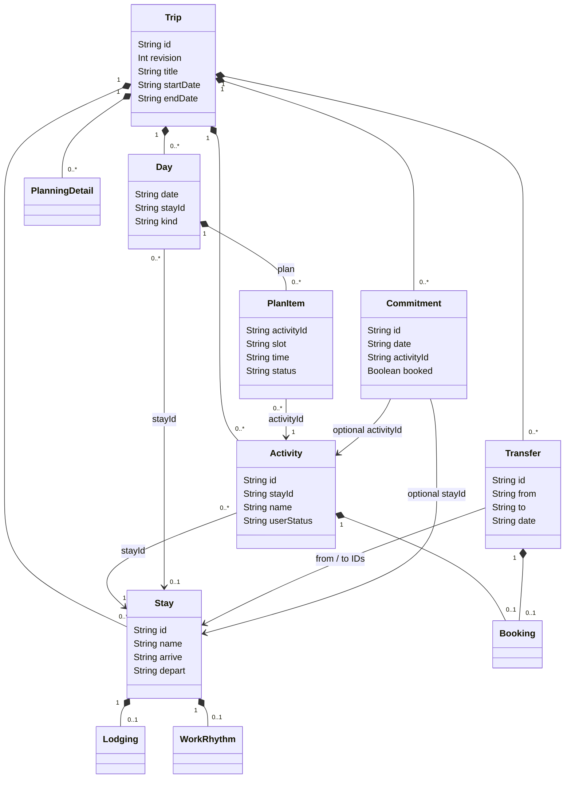
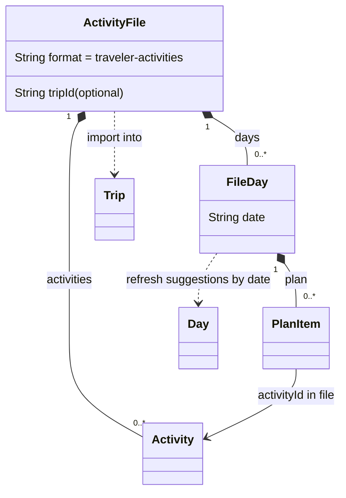

# Key data models

Traveler stores a trip as one document. These UML class diagrams show its core relationships; optional descriptive fields are omitted. Class names match the [Kotlin models](../app/src/main/kotlin/dev/tlong/traveler/model/Trip.kt).

## The trip document

- **Itinerary** is a view of days and their plans, not a separate stored class. Activities belong to the trip’s pool and refer to a stay; plan items refer to activities rather than copying them.
- **Lodging, transfers and commitments** carry reservation facts. `PlanningDetail` carries logistics research and candidate options, keyed to bookable items; see [its model](../app/src/main/kotlin/dev/tlong/traveler/model/PlanningDetail.kt).
- Solid diamonds mean ownership within the document; arrows mean references by ID. IDs remain stable across revisions; days are identified by date.

## Daily Activity Patch

A patch is an `ActivityFile` (`traveler-activities`) with dated plans. The same format without days simply adds activity ideas.

Import matches activities to stays and existing ideas. Each selected date replaces that day’s suggestions while preserving completed items, booked activities and user-created entries. Dates outside the trip are skipped. See the [activities-file contract](trip-format.md) for fields and matching rules.

## What stays on the phone

| Stored alongside the trip | Purpose |
| --- | --- |
| `TripRow.baseJson` / `localJson` | Last imported document and the traveler’s edited document: the basis for merging a revision. |
| `SnapshotRow` | Previous versions for history and recovery. |
| `TripRow.notes`, `checklist`, `work` | Personal trip notes, preparation lists and work-block adjustments. Included in backups, omitted from trip exports. |

See [Architecture](ARCHITECTURE.md) for persistence and merge behavior, or the [format reference](trip-format.md) for the complete field contract.
