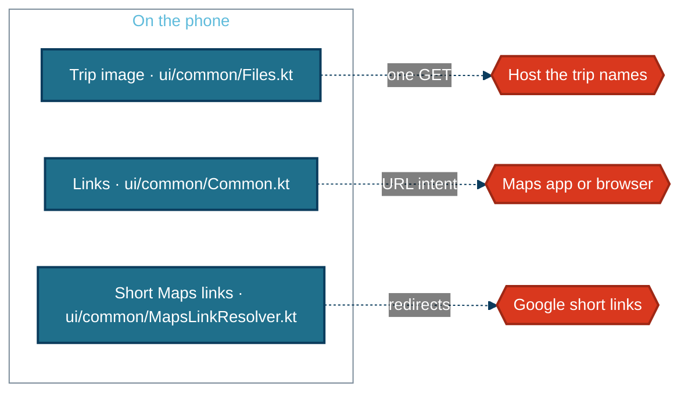

# External services and data sources

Everything the app or the build tools reach off the machine they run on. It was read from the client code, not from the README or the app's Settings page.

## At a glance

Nothing here needs a key or an account, and nothing sends your trip. Importing, planning, booking, exporting and backing up work with no network at all. The app draws no maps and fetches no map tiles, and the build tools reach nothing: `tools/make_map.py` writes a file you import into Google My Maps yourself.

## The services

| Service | What is sent | What comes back | Key | When it is down |
|---|---|---|---|---|
| The trip's own image, at the `tripMap.imageUrl` the file names | One GET to that address, once | An image, kept in `filesDir/images` | none | No image is shown; the stay calendar and key stand alone |
| Google's short-link redirect, for a `maps.app.goo.gl` link you paste under **Set location** | A request for that link and each address it redirects to (at most six), only when you tap Save | Redirects; the app reads coordinates only from the redirect addresses, never from the page, whose map is centred on the requester's own location | none | The dialog says it couldn't find coordinates and suggests copying them from a dropped pin |
| Google Maps, a day's 🧭 directions, Google search, booking and activity links | Nothing from the app: it hands the URL to the phone, which opens the Maps app or a browser | — | none | The other app reports it. Map links say so first when the phone is offline |

**The Settings page says the same.** Its Privacy text (`ui/settings/SettingsScreen.kt:154`) names the trip's overview image and the short-link lookup you trigger by pasting one, and says no trip details are sent.

*Generated from 72c887b on 2026-10-05.*
